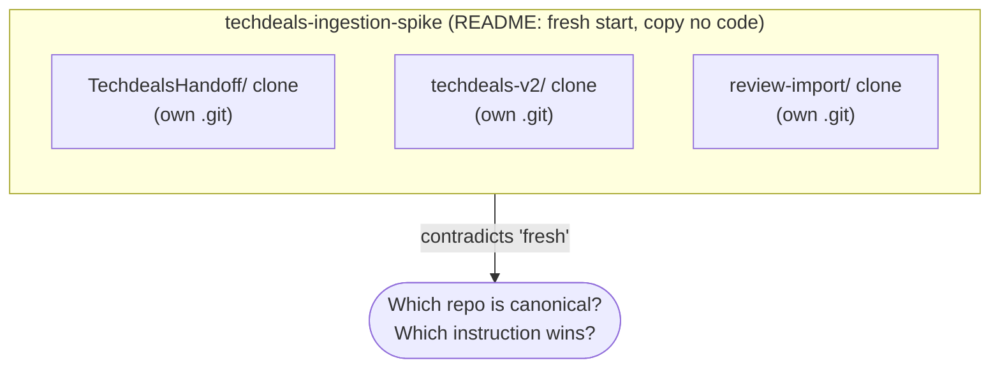
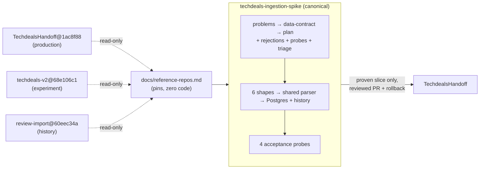
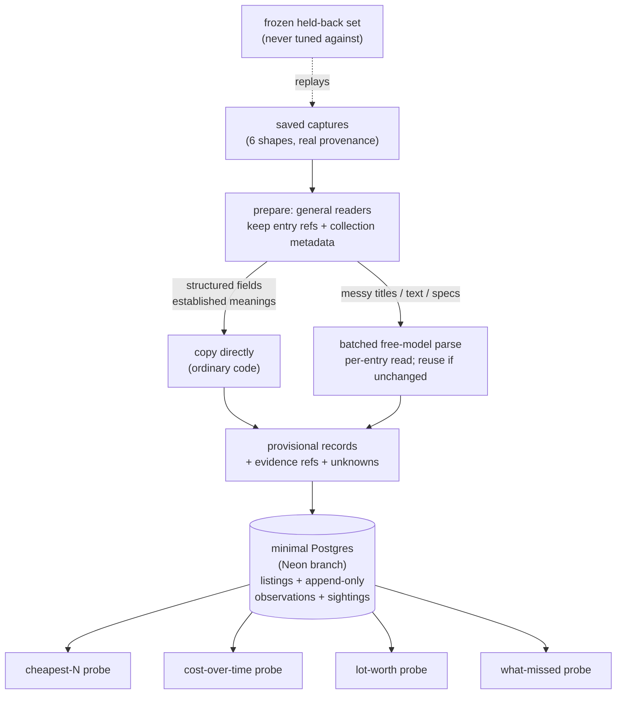

# TechDeals unification into one repo — plan

Status: in progress, 2026-10-24. Decision made by planner after owner delegated target choice ("you figure it out").
Canonical target: `techdeals-ingestion-spike` (this repo). All other repos are read-only reference. No production change authorized.

Ultimate goal: turn scattered hardware listings (retailer pages, eBay captures, Reddit posts, auction lots, CSV exports) into one database that other agents can query for buying analysis: what is for sale, what configuration it has, what the seller's price covers, what changed over time, and what remains unknown, with every fact traceable to its source capture.

Progress: Phase 0 done (nested clones deleted, pins in `docs/reference-repos.md`). Phase 1 done (rejections + probes appended to `docs/problems.md`). Phase 2 triage is decided below; still to materialize as `docs/idea-triage.md` (currently a dangling link from `problems.md`) — first task for the implementation agent.

Grounding caveat (2026-10-24): this triage was first built from design docs only, but GitHub live state has now been inspected. Findings:
- Spike PR #3 (`feat/sprint-one-parser`, OPEN, updated 10-17) carries its own architecture: `docs/design.md` specifies a direct Entry/Price extraction interface that explicitly rejects the earlier graph prototype (batch→units→offers→items with model-invented IDs). Flat entries, prices nested under the entry they describe, app owns IDs/identity/dates, JSONB for variable attributes, PydanticAI with bounded correction. This is the settled implementation direction and it supersedes the abstract parser-output discussion as the concrete baseline.
- PR #3's branch already has corpus (`corpus/native/dev-a/*`, `holdout-c/*`, `oracle/expected.json`), `src/techdeals_ingestion/` (models, parser, storage, schema.sql), `config/parser.toml` (model `nvidia/nemotron-3-super-120b-a12b:free`), and 25 passing parser/CLI/source tests per its description. Verified live: single-product run correct on title/IDs/SKU/price 14.99 with nulls preserved; dates incomplete (5 of 11); 57s over 2 requests.
- Draft PRs #4 (DSPy RLM review harness) and #5 (OpenCode coding-agent extractor harness) are explicitly probes, not engines; both stacked on PR #3, both state they are not accepted ingestion paths.
- Issue #7 (OPEN, 10-23): six local commits stranded on `/home/coldaine/projects/techdeals-ingestion-spike`, diverged (ahead 6, behind 43). They contain the `offline` CI fix (executable bit on `scripts/freeze_corpus.py`) plus a further direction change: `Remove docs/plan.md`, `Reduce docs to problem framing; remove design rules`, MiMo-flash parser switch, one conversation per linked group. This local direction (docs = problem framing only) conflicts with both main's plan and PR #3's design.md and is unpushed.
Code-level retain/reject claims elsewhere in this plan remain secondhand until verified against PR #3's diff and the pinned engine code. The triage below must be rebased onto `docs/design.md` as the architecture baseline once the owner confirms.

## 1. Goal

One greenfield repo that proves a single capture-to-answer path over varied real hardware listings, then uses that proof to decide what (if anything) enters `TechdealsHandoff`.

Authoritative requirement sources, in precedence order:
1. `docs/problems.md` + `docs/data-contract.md` + `docs/plan.md` in this spike (2026-10-16, latest dated owner-aligned docs).
2. `techdeals-v2/docs/project-goal.md` (goal statement) + 4 target queries from `techdeals-v2/BRIEF.md` §6 as evaluation probes, not schema mandates.
3. `TechdealsHandoff/docs/NORTH_STAR.md` G1–G5 / AG1–AG9 as production-consumer constraints to check against, not to implement here.

Explicit non-goals for this unification (do not build):
- No new scrapers/collectors/schedules; prove from saved captures first (`spike plan step 1`, `v2 BRIEF Req 1`).
- No cost-apportionment / lot-price division; preserve stated scope, use `bound_only`-style ambiguity (spike P3, v2 project-goal). Owner verbatim "apportion" in BRIEF §8 is superseded by later spike + project-goal prohibition — record as rejected.
- No fixed 12-category taxonomy as schema requirement; categories develop with evidence (spike P7). Handoff's 12 projections are reference, not DDL to copy.
- No legacy corpus migration, scoring/ranking, confidence numbers, production deployment until path is demonstrated.

## 2. Current state (verified 2026-10-24)

- This spike: draft requirements + contract + plan only. `README.md:40` confirms implementation has not started.
- Nested clones contaminate this checkout (violates spike plan "clean checkout" rule, step 5):
  - `TechdealsHandoff/` (production, full app + sql + contracts)
  - `techdeals-v2/` (posting-first experiment, `engine/extract.py`, `src/techdeals/ingestion/loaders.py`, Neon scratch `winter-brook-99288103`)
  - `techdeals-v2-review-import/` (transferred personal history, 6 open PRs at 2026-10-15 snapshot)
- Conflicts resolved by recency + owner-instruction precedence (spike wins on contradictions):
  | Conflict | Resolution |
  |---|---|
  | Canonical repo: v2 README says v2 is canonical vs spike README says fresh here | Spike is canonical for new proof; v2 consolidation PR history stays in v2, not replayed here |
  | Identity: Handoff canonical keys from price-determining facts vs v2 lazy position-path `offer_key` vs spike stable source/native ID, no model merge | Spike rule wins: stable source/native ID + variant context; different sellers never merge; unresolved identity retained explicitly (data-contract L313-321) |
  | Apportionment: BRIEF verbatim "apportion" vs later prohibition | Prohibited. Preserve scope/ambiguity |
  | Parser: one-per-call engine in Handoff PR #222 vs batched free-model requirement | Batched `nvidia/nemotron-3.5-lightning:free` via OpenRouter, Doppler-injected key, no `.env` autoload; reuse valid interpretation for unchanged content (data-contract L244-283) |
  | Secret/DB: Doppler `apps-data/dev` vs `ai-automation/dev`, Neon branch vs cluster PG | Spike wins: Doppler env injection only; isolated Neon branch; never touch cluster/production |

## 3. Phase 0 — Decontaminate checkout (prerequisite, no code)

Why: nested `.git` dirs hide from `git status`, break "clean checkout" demo, and invite accidental code copying which spike README forbids.

Steps for implementer:
1. Record remote pins in unification log (do not rely on local clones): `TechdealsHandoff@1ac8f887`, `techdeals-v2@68e106c1`, `review-import@60eec34a` + reviewed branch `88ff05e9` (from `parsing-usefulness-and-integration.md` table).
2. Delete `TechdealsHandoff/`, `techdeals-v2/`, `techdeals-v2-review-import/` subdirectories from this working tree (plain filesystem delete; no git worktrees per Handoff AGENTS.md rule — these are full clones, worse).
3. Verify: `git status --short` shows only deletions of untracked nested dirs (or clean if they were never tracked); `Get-ChildItem -Force` shows no nested `.git`; `docs/` + `README.md` + `AGENTS.md` intact.
4. Future reference via remote URLs/pins only, or sibling dirs outside this repo (e.g. `../_swarm/<name>`), never subdirs.

Validation: `git status` clean except plan file; no `*/.git` under spike root.

## 4. Phase 1 — Single goal page (docs-only, 1 PR)

Create no new architecture docs. Reconcile in place:
- Keep `docs/problems.md` as the binding required-result list (P1–P7).
- Append explicit rejection notes (apportionment, fixed taxonomy, scraper-first) with links to superseded verbatim, so a new agent does not re-litigate.
- Map v2's 4 queries (cheapest-N, cost-over-time, lot-worth, what-missed) as acceptance probes under spike plan steps 2/6, not as schema.
- Map Handoff NORTH_STAR G1–G5 as consumer checks for later incorporation review.

Done when: a cold agent can read `README → problems → data-contract → plan → this unification plan` and state what is out of scope without opening v2/Handoff.

## 5. Phase 2 — What survives, newest first (materialize as `docs/idea-triage.md`)

Sources ranked by recency and authority. Older items are not re-read unless the newer ones leave a gap. The implementation agent's first task is to write this section to `docs/idea-triage.md` (fixing the dangling link in `problems.md`), then proceed to Phase 3.

**Binding (spike docs, 2026-10-16 — implement these):** the 6 input shapes through one path; per-entry interpretation with reuse for unchanged content; listing-vs-scrape identity, the 9 rescrape cases, the 4 date meanings; append-only observations with evidence traceability and unknown-preserving intake.

**Live edge (v2 project-goal + open issues #16–20 — use as checks):** the goal statement's five proof demands (preserve evidence, represent the purchase, support comparison, preserve continuity, demonstrate through the application); the four probes (cheapest-N, cost-over-time, lot-worth, what-missed) as end-to-end exercises, never as schema.

**Consumer constraints (Handoff NORTH_STAR G1–G5/AG1–AG9 — check at incorporation only):** evidence-backed objects, twelve projections as reference (not DDL), Python-owns-writes boundary, fail-closed paid policy. Nothing here is built in the spike.

**Superseded (do not follow, recorded so they stay dead):** BRIEF verbatim "apportion the lot price"; fixed taxonomy as schema; scraper-per-source implementation; model-generated identity or confidence scores; PR #222's one-per-call pattern (semantics worth knowing, calling pattern rejected); any copied `sql/` / `engine/` / `src/` implementation; TimescaleDB, schedules, bulk legacy import, production cutover.

**Examples, never directives:** the EPYC-1P corpus curation method (fixture-quality bar); the Handoff fixture paths named in the data contract (inspection leads, not acceptance).

## 6. Phase 3 — Fresh proof slice (follows spike plan steps 1–6, unchanged)

Do not shortcut. Implementer executes spike `plan.md` steps 1–6 verbatim against the triaged vocabulary:
1. Assemble bounded dev + frozen held-back capture sets covering all 6 shapes with real provenance; record fixture paths, source/collection metadata, excerpts; label authored vs real (Handoff fixtures listed in data-contract L109-117 are leads, not acceptance).
2. Write expected input→record examples + representative SQL reads before schema.
3. Define provisional parser-output schema (items/variants, prices with kind/scope, attributes, source dates, unresolved).
4. Build shared batch parser (Python+Instructor proposed; verify against free endpoint first), file-based inspectable output, demonstrate unchanged-content reuse + changed-content reinterpretation.
5. Add minimal Postgres persistence on isolated Neon branch with history/dedup per rescrape table; clean-checkout runnable; Doppler env only.
6. Verify via agent queries + frozen held-back run; count omissions/wrong associations/inventions/lost dates as failures.

Each step's "Done when" is in `plan.md` — enforce literally. Passing JSON validity, row counts, or checks alone never completes a step.

## 7. Phase 4 — Incorporation decision (separate, after proof)

Only after Phase 3 passes: compare spike path vs Handoff writer/consumer on same captures; propose one bounded improvement PR to Handoff with before/after consumer readback, history impact, rollback. This plan does not authorize that PR — owner + Handoff workflow approval required.

## 8. Risks

- Re-importing code by habit — mitigated by Phase 0 deletion + "no copy" rule in review.
- Overfitting to EPYC or one shape — mitigated by 6-shape + held-back requirement.
- Invented dates/IDs by LLM — mitigated by ordinary-code identity/dedup + unresolved-explicit rule.
- Secret leakage into artifacts — mitigated by Doppler-only, no `.env`, artifact secret scan.

## 9. Validation checklist for this unification plan

- [x] Nested clones removed; no nested `.git`; pins recorded in `docs/reference-repos.md`.
- [x] Single precedence chain readable cold; rejections + probes in `docs/problems.md`.
- [ ] Triage table materialized as `docs/idea-triage.md`; no implementation copied.
- [ ] Spike steps 1–6 executed with real captures + held-back set; queries trace to evidence.
- [ ] No production/cluster touched; no paid calls in CI.

## 10. Diagrams

### Before: three authorities + nested clones

### After: one canonical repo, references by pin

### Capture-to-answer path (the thing being proved)

## 11. Cross-repo landing ledger (surveyed 2026-10-24, verified by subagents)

- Spike PR #8 (docs bookkeeping) OPENED by this pass; PR #3 branch received EXE001 mode-bit fix (`f9dd50f` → `a56c3b4`), offline CI re-running.
- v2: 1 open PR (#27 lock maintenance, CLEAN, landable after rebase for #28 policy). 5 open issues, all keep-open tracking (#16, #17, #18, #20, #29 dashboard). Consolidation PR #19 MERGED 10-16. v2 `main` is canonical; review-import `main` is content-identical (mirror for review tooling).
- review-import: 1 open PR (#10 lock maintenance, BLOCKED only by unresolved Devin thread on `uv.lock:2` + stale base). 1 open issue (#12 dashboard, resolves when Renovate has nothing to track).
- Handoff: 8 open PRs, 18 open issues (complete lists, no truncation). Ingestion-relevant: #228 posting-centric intake SQL (MERGEABLE/BEHIND, awaiting review), #227 intake docs (CHANGES_REQUESTED + failing review-kit check), #222 LLM-first ingestion (draft, stacked on `integration/collection-workbench`, cannot land on main first), #220 corpus replay (Greptile FAILURE), #209/#238 drafts. Relevant issues: #226 source inventory, #224 EPYC inbox, #223 workbench pivot, #232 LLM parsing, #233 OOS handling, #229/#37/#172/#163. Nothing in Handoff is unilaterally landable; every item needs review action, a rebase, or its integration branch.
- Spike PR #3 `offline` CI now PASSES on `a56c3b4` (verified 2026-10-24). Remaining blockers: CHANGES_REQUESTED reviews + issue #7's rebase.

Landing order: spike #8 (docs, needs a reviewer) → spike #3 (after P1 threads clear + #7 rebase lands) → rebase spike #4/#5 → v2 #27 + review-import #10 (trivial, either order) → Handoff #228/#227/#220 per their owners. Issues v2 #16–#20 and Handoff #226/#224/#223/#232 stay open as Phase-3 acceptance trackers.

## 12. Owner decisions (2026-10-24)

- DECIDED: PR #3's `docs/design.md` is the surviving architecture. The stranded docs-wipe commits (`1dc26a1`, `e87378a`) are rejected; do not land them. Issue #7's remaining value is only the three parser/locator hardening commits, re-doable here if needed.
- DECIDED: stay on whatever is free. Committed config is `nvidia/nemotron-3.5-lightning:free` (super-120b's free route 404s at the provider), reasoning off, no paid fallback.
- AUTHORIZED: build the `design.md` execution path on the PR branch; PR body's "do not continue" gate is lifted by this decision.

## 13. Build record, PR #3 branch (2026-10-24, 15 commits on feat/sprint-one-parser)

Proven live against the exercise Neon branch, all costs $0:
- small-a: 2 entries, 2 prices, completed. dev-a: 6/6 batches complete, 29 entries, 20 prices in Postgres, read back through `query`.
- Reingest reuse: completed batches serve from cache with zero model calls (verified -011, -013).
- Price-change observation: 14.99 -> 12.99 stored with full evidence (attempt 3158dc7b).
- Suite: 67 passed, 4 skipped (live-Neon tests skip without Doppler).

Findings that changed the code (each with a test):
1. super-120b:free is dead at the provider (404, "not found for account"); lightning:free answers.
2. This model with reasoning on burns the whole output budget thinking and never calls the tool; reasoning stays off for it.
3. Mixed-namespace batches degrade the model (dropped amounts); one namespace-group per call.
4. Whole-price matching assumed prose; CSV/JSON-array commas broke it (fixed + unit-tested).
5. Ambiguous null amounts are now filled deterministically when the original holds exactly one amount; wrong amounts still fail; evidence checks still reject non-money text.
6. Prompt gaps closed: verbatim date fields, counts-are-never-prices, no receipt IDs as input_ids, exact-field locators, native_id required for identity.
7. Windows checkouts rewrote corpus line endings and broke sha256 pins; `corpus/** -text` guard added.

Known residual (not hidden): cross-run identity linkage is model-dependent. The 14.99 and 12.99 observations verifiably describe the same variant (44864662864150 / U2AIC_NB) but carry different native_id extractions (product id vs variant id), so their identity_keys differ. Options: stronger native_id instruction (tried, partial), deterministic identity fallback (architecture call, affects Handoff alignment), or accept unresolved-until-agreeing. Recommend deciding this before the incorporation gate, not before more parsing.

## 14. Open / deferred (not blocking)

- Exact dev vs held-back fixture IDs (chosen in Phase 3 step 1 from inspected captures).
- Whether compact sightings vs full copies for history (data-contract L377-383) — decided after parser inspection.
- Neon project/branch IDs for this spike (create isolated branch; do not reuse v2 `winter-brook-99288103/main` without owner confirm).
